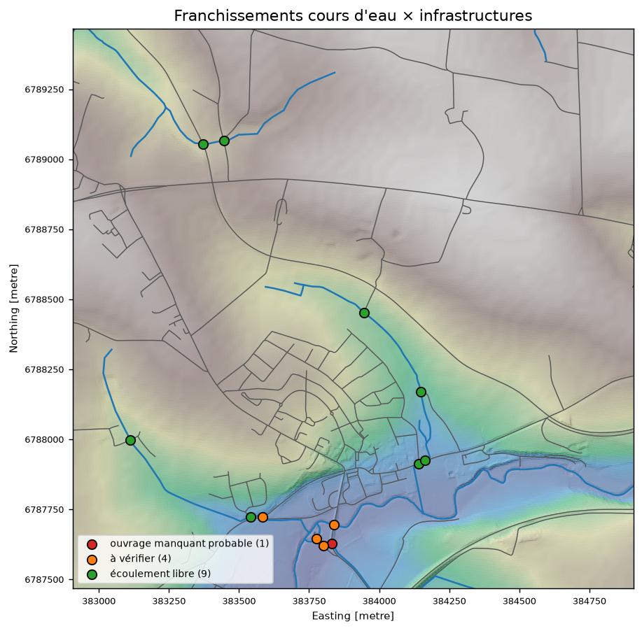
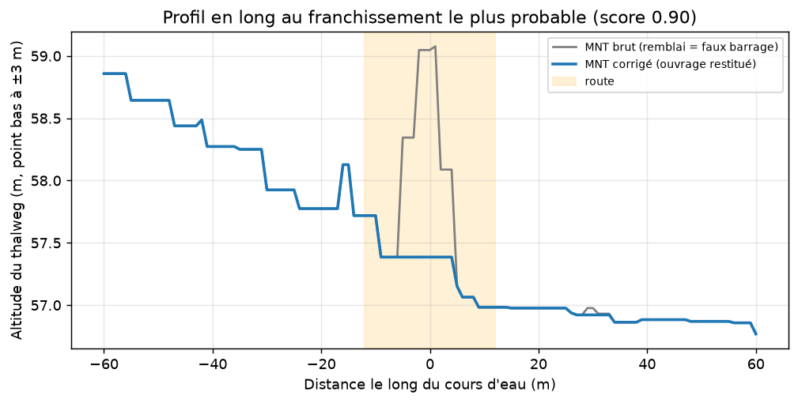
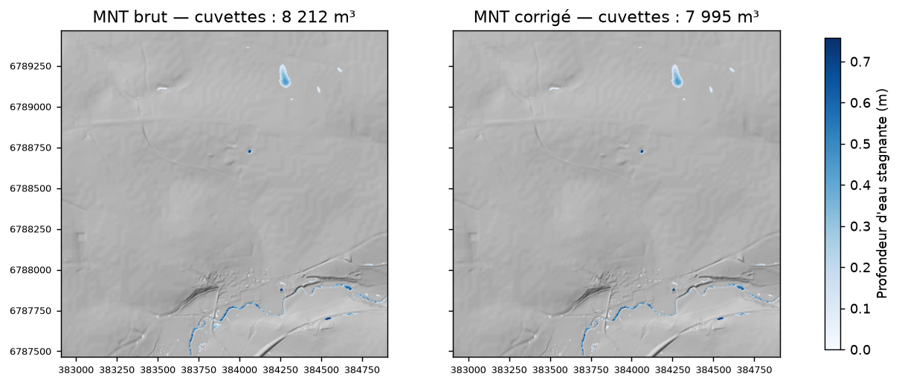

# culvert-finder 🌊

**Détection automatique des ouvrages hydrauliques (buses, ponts) absents des MNT LiDAR, et correction du MNT pour la modélisation hydraulique.**

[](https://github.com/myriam-idam/culvert-finder/actions/workflows/tests.yml)


## Le problème

Dans un MNT issu du LiDAR, les remblais de routes et de voies ferrées apparaissent comme des **digues continues** : les buses et les petits ponts qui les traversent sont invisibles. Pour un modèle hydraulique (HEC-RAS 2D, Telemac, Mike…) ou une analyse hydrologique, chaque remblai devient alors un **faux barrage** qui retient l'eau en amont et fausse les écoulements, les zones inondables et les bassins versants.

Ces ouvrages se corrigent aujourd'hui **à la main**, un par un, ce qui prend des heures sur chaque étude.

## Ce que fait l'outil

```
Zone d'étude ──► MNT RGE ALTI + BD TOPO (IGN) + OpenStreetMap
                 │
                 ├─ 1. Franchissements cours d'eau × routes / voies ferrées
                 ├─ 2. Profil en long du MNT au droit de chaque franchissement
                 ├─ 3. Indicateurs : hauteur du remblai, cuvette créée en amont
                 ├─ 4. Score « ouvrage manquant » (0 à 1) et classement
                 ├─ 5. Creusement automatique d'un chenal dans le MNT
                 └─ 6. Validation croisée avec les buses / ponts OpenStreetMap
                 │
                 ▼
   mnt_corrige.tif · culvert_finder.gpkg (QGIS) · rapport.html
```

| Sortie | Contenu |
|---|---|
| `mnt_corrige.tif` | MNT prêt pour la modélisation, ouvrages restitués |
| `culvert_finder.gpkg` | Franchissements avec score, classe et indicateurs, à vérifier dans QGIS |
| `cuvettes_avant.tif` / `cuvettes_apres.tif` | Hauteur d'eau stagnante avant et après correction |
| `rapport.html` | Carte, profil en long avant/après, tableau, indicateurs clés |

## Résultat sur une zone réelle

Zone de 2 km × 2 km près de Vitré (Ille-et-Vilaine), avec les données IGN et OpenStreetMap téléchargées automatiquement, analysée en moins de 2 minutes :

| Indicateur | Valeur |
|---|---|
| Franchissements cours d'eau × routes / voies ferrées analysés | 14 |
| Ouvrages manquants probables (corrigés dans le MNT) | 1 |
| Franchissements à vérifier | 4 |
| Volume de cuvettes artificielles supprimé au droit de l'ouvrage | **−81 %** (146 → 27 m³) |



**Profil en long au franchissement détecté :** le remblai routier (1,4 m) bloquait l'écoulement dans le MNT. Après correction, l'eau s'écoule de façon continue de l'amont vers l'aval.



**Contrôle de cohérence avec OpenStreetMap :** les franchissements où une buse est déjà cartographiée ont presque tous un score bas, car le MNT y montre déjà le passage de l'eau. Le franchissement détecté n'a aucun ouvrage connu à moins de 58 m : c'est un point à vérifier en priorité sur le terrain.



## Installation

```bash
git clone https://github.com/myriam-idam/culvert-finder.git
cd culvert-finder
python -m venv .venv
.venv\Scripts\activate          # Windows  (Linux/macOS : source .venv/bin/activate)
pip install -e .
```

## Utilisation

**Démonstration hors ligne** (scène synthétique, sans téléchargement) :

```bash
culvert-finder demo --sortie sortie_demo
```

**Zone réelle** à partir d'un point (longitude, latitude) et d'une taille de zone en mètres :

```bash
culvert-finder analyse --point -1.55 48.10 --taille 2000 --sortie ma_zone
```

**Zone réelle** à partir d'une emprise en Lambert 93 :

```bash
culvert-finder analyse --emprise 352000 6788000 354000 6790000 --sortie ma_zone
```

**Avec votre propre MNT** (par exemple une dalle LiDAR HD de l'IGN, en Lambert 93) :

```bash
culvert-finder analyse --mnt dalle_lidar_hd.tif --sortie ma_zone
```

Utilisation en Python :

```python
from culvert_finder import analyser, Parametres
res = analyser(mnt, transform, cours_eau, infrastructures, ouvrages_osm, Parametres(seuil_correction=0.5))
res.franchissements.to_file("franchissements.gpkg")
```

## Méthode

1. **Franchissements** : intersection des tronçons hydrographiques (BD TOPO, assemblés en lignes continues) avec les tronçons de route et de voie ferrée.
2. **Profil en long** : le MNT est échantillonné le long du cours d'eau sur ±40 m. Chaque point est « accroché » au point bas situé à moins de 3 m, car le tracé vectoriel n'est pas exactement sur le thalweg.
3. **Hauteur de remblai** : point haut au droit de l'infrastructure, moins le plus haut des deux points bas amont et aval. Elle mesure de combien l'eau doit monter pour franchir l'obstacle.
4. **Cuvette** : les dépressions du MNT sont comblées par reconstruction morphologique (Soille, 2004). La profondeur d'eau stagnante autour du franchissement révèle le faux barrage.
5. **Score** = 60 % hauteur de remblai + 40 % profondeur de cuvette, normalisé entre 0 et 1.
   - ≥ 0,6 : *ouvrage manquant probable*, corrigé dans le MNT
   - 0,3 à 0,6 : *à vérifier*
   - < 0,3 : *écoulement libre*
6. **Correction (breaching)** : un chenal suit le thalweg réel, cellule par cellule, du point bas amont au point bas aval. Le long de ce chemin, l'altitude est rendue non croissante. Seules les cellules qui bloquent l'écoulement sont abaissées : le MNT n'est jamais relevé, aucun creux n'est créé et les cuvettes naturelles voisines (mares, plaine alluviale) ne sont pas agrandies.
7. **Validation** : les franchissements sont croisés avec les buses (`tunnel=culvert`) et les ponts (`bridge=*`) d'OpenStreetMap, ainsi qu'avec l'attribut « position par rapport au sol » de la BD TOPO.

## Données

| Donnée | Source | Licence |
|---|---|---|
| MNT RGE ALTI 1 m | IGN, Géoplateforme (WMS-R) | Licence Ouverte 2.0 |
| Cours d'eau, routes, voies ferrées | IGN, BD TOPO v3 (WFS) | Licence Ouverte 2.0 |
| Buses et ponts | OpenStreetMap (API Overpass) | ODbL |

Toutes les données sont téléchargées automatiquement : aucune inscription ni clé d'API n'est nécessaire.

## Limites connues

- Le score repose sur des règles expertes (v1). Les seuils sont réglables dans `Parametres`.
- Les cours d'eau absents de la BD TOPO (fossés, petits talwegs) ne sont pas analysés.
- La correction ne représente pas la capacité hydraulique de l'ouvrage (diamètre, pertes de charge). Elle rétablit seulement la continuité de l'écoulement dans le MNT.
- Les zones très grandes (plus de 25 km² à 1 m) demandent beaucoup de mémoire : il vaut mieux les découper.

## Feuille de route

- [ ] Score par apprentissage automatique (LightGBM), entraîné sur les buses OpenStreetMap
- [ ] Détection de franchissements sans BD TOPO, à partir du réseau d'écoulement calculé (fossés)
- [ ] Export direct des ouvrages vers HEC-RAS 2D (SA/2D connections) et Telemac
- [ ] Plugin QGIS
- [ ] Démo en ligne (Streamlit)

## Tests

```bash
pip install -e ".[dev]"
pytest
```

## Licence

MIT. Données © IGN (Licence Ouverte 2.0) et © contributeurs OpenStreetMap (ODbL).
